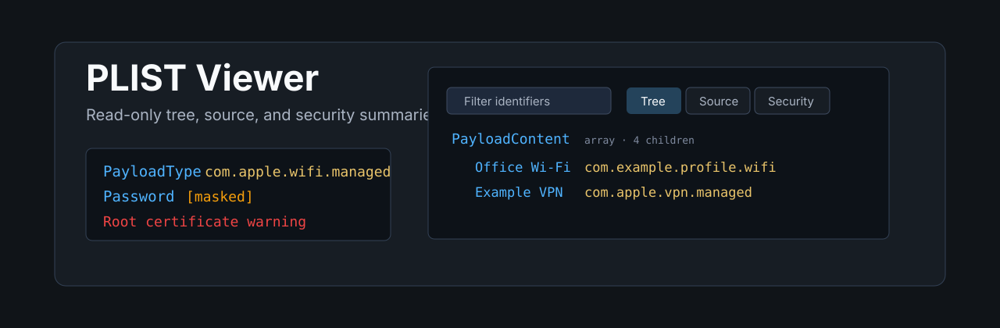
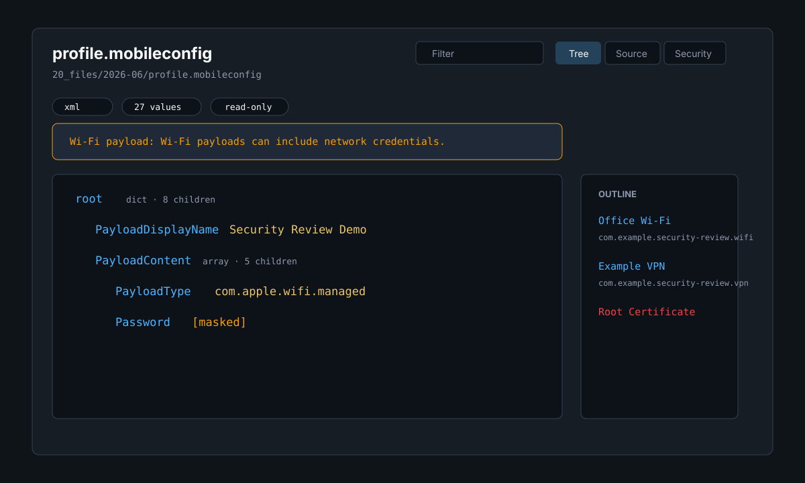

<p align="center">
  
</p>

<p align="center">
  <a href="https://github.com/viggomeesters/obsidian-plist-viewer/releases/latest"></a>
  <a href="LICENSE"></a>
  
  
</p>

# PLIST Viewer

PLIST Viewer is a read-only plugin for inspecting Apple `.plist` and `.mobileconfig` files as typed trees, line-numbered source, and configuration profile security summaries.

It is built for local inspection of property lists, MDM and configuration profile exports, Wi-Fi payloads, VPN payloads, certificates, restrictions, and payload identifiers. It does not install, activate, enroll, trust, sign, provision, or apply profiles.



## Features

- Opens `.plist` and `.mobileconfig` files in a dedicated read-only view.
- Parses XML plist values into typed nodes: dict, array, string, integer, real, bool, date, and data.
- Detects binary plist headers and shows a safe unsupported state instead of attempting conversion.
- Shows a tree view with key paths, type badges, masked secret-like values, search, and an outline.
- Shows a source view with line numbers and lightweight XML highlighting.
- Shows a security view for configuration profiles with profile metadata and payload summaries.
- Warns for MDM, Wi-Fi credentials, VPN, certificates, root certificates, restrictions, unknown payload types, sensitive values, and removal-disallowed profiles.
- Keeps invalid XML, binary files, and large files inspectable through explicit fallback states.
- Provides a refresh button for files changed outside the app.

## Security model

PLIST Viewer is intentionally inspect-only:

- It never installs or activates `.mobileconfig` profiles.
- It never performs MDM enrollment, provisioning, signing, certificate validation chain checks, or trust decisions.
- It never writes `.plist` or `.mobileconfig` files back to disk.
- It does not convert binary plists into new files in v0.1.
- It does not open macOS or iOS system dialogs or external apps.
- It does not use network APIs or clipboard APIs.
- It does not use dynamic code execution.

The plugin reads file contents through the vault API and renders a local view. Secret-like values are masked in the tree view where practical; the source view remains a local raw inspection view.

## Binary and large files

Binary plist support in v0.1 is detection-only. Files starting with the `bplist00` header are reported as unsupported with a clear warning. Large files use a safe fallback or render cap to avoid freezing the interface.

## Installation

### Community plugin directory

PLIST Viewer is prepared for Community plugin directory submission. Once accepted, it can be installed from **Settings -> Community plugins -> Browse**.

### Manual installation

Until the community directory submission is accepted:

1. Download `main.js`, `manifest.json`, and `styles.css` from the [latest release](https://github.com/viggomeesters/obsidian-plist-viewer/releases/latest).
2. Create this folder in your vault: `.obsidian/plugins/plist-viewer/`.
3. Put the downloaded files in that folder.
4. Reload the app.
5. Enable **PLIST Viewer** in **Settings -> Community plugins**.

### BRAT installation

For beta testing, install the plugin with [BRAT](https://github.com/TfTHacker/obsidian42-brat) using this repository URL:

```text
https://github.com/viggomeesters/obsidian-plist-viewer
```

## Usage

Open any `.plist` or `.mobileconfig` file in your vault. The file opens with PLIST Viewer.

Use the toolbar to:

- filter keys, values, payload types, and identifiers
- switch between tree, source, and security views
- refresh the file after external changes

Invalid XML, unsupported binary plist files, and large files show explicit fallback states so the viewer does not crash or silently apply anything.

## Development

```bash
npm install
npm run build
npx tsc --noEmit
npm test
```

For local development, copy or symlink this repository into `.obsidian/plugins/plist-viewer/` inside a test vault.

## Release process

Community plugin files are installed from GitHub releases. For each release:

1. Update `manifest.json`, `package.json`, and `versions.json`.
2. Run `npm install`, `npm run build`, `npx tsc --noEmit`, and `npm test`.
3. Create a GitHub release whose tag exactly matches `manifest.json.version`.
4. Attach `main.js`, `manifest.json`, and `styles.css` as release assets.

## Community directory submission

Submit this repository URL:

```text
https://github.com/viggomeesters/obsidian-plist-viewer
```

The repository contains the expected root plugin files, security-focused documentation, parser fixtures, runtime assets, and version metadata for a v0.1.0 release.

Official references:

- [Submit your plugin](https://docs.obsidian.md/Plugins/Releasing/Submit%20your%20plugin)
- [Obsidian releases repository](https://github.com/obsidianmd/obsidian-releases)

## License

[MIT](LICENSE)
